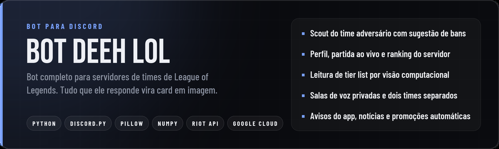
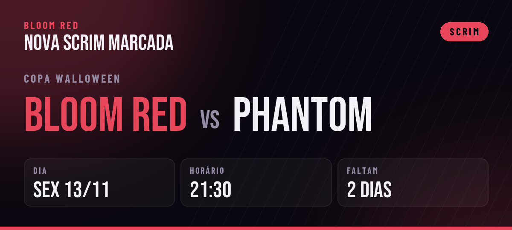
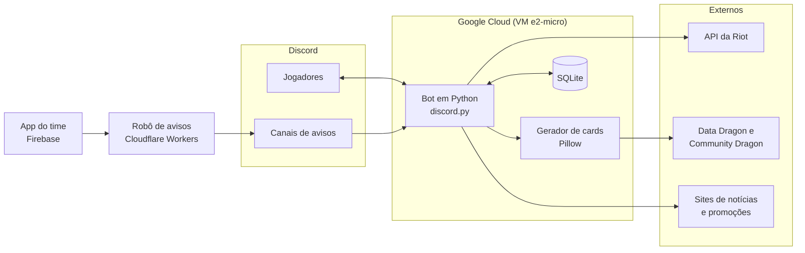

<div align="center">



</div>

# Bot Deeh LOL

Bot de Discord feito para o servidor de times competitivos de League of Legends. Ele junta em um só lugar
o que o time usa no dia a dia: análise de adversários, perfil e elo dos jogadores, organização do servidor
e os avisos do aplicativo do time. Quase tudo que o bot responde é um card em imagem, desenhado na hora.

Está em produção 24 horas por dia, atendendo dois times (Bloom White e Bloom Red) no mesmo servidor.

## Sumário

- [Funcionalidades](#funcionalidades)
- [Comandos](#comandos)
- [Arquitetura](#arquitetura)
- [Decisões técnicas](#decisões-técnicas)
- [Estrutura do projeto](#estrutura-do-projeto)
- [Como rodar](#como-rodar)
- [Hospedagem](#hospedagem)

## Funcionalidades

### Scout do time adversário

O comando `/scout` recebe o link da multibusca do OP.GG, o texto copiado do saguão ou uma lista de nicks e
analisa os cinco jogadores pela API oficial da Riot. O resultado é um card com uma linha por jogador:

- rota de cada um, com a porcentagem de partidas jogadas nela. As rotas são atribuídas sem repetição,
  testando todas as combinações possíveis;
- elo, PDL, taxa de vitória e a sequência das últimas partidas;
- KDA, participação em abates, farm por minuto e parcela do dano do time;
- os três campeões mais jogados de cada um;
- sugestão de bans, priorizando o campeão que o jogador mais joga e com que mais vence;
- uma leitura do time: maior ameaça, ponto fraco, quem está em sequência, quem é mono e quem está fora da rota.

As análises ficam em cache por jogador e rodam uma de cada vez, para respeitar o limite da Riot sem travar o bot.

### Jogadores e elo

- `/vincular` liga a conta da Riot ao Discord. A verificação é feita pelo ícone de perfil, e o bot dá o
  cargo do elo automaticamente.
- `/perfil` gera um card no estilo de transmissão de esports: elo Solo e Flex, resumo das últimas partidas e
  o campeão mais jogado como fundo.
- `/partida` mostra a partida ao vivo de um jogador: campeões, feitiços, runas, elo e taxa de vitória dos dez.
- `/ranking` monta o ranking de elo do servidor.
- A cada 10 minutos o bot avisa quem subiu ou caiu de elo e publica o resumo de cada ranqueada
  (resultado, KDA, itens, dano, farm, ouro e visão).

### Organização do servidor

- **Dois times no mesmo servidor.** Cada time tem a sua área, os seus cargos (capitão, coach, titular e
  reserva) e as suas salas de voz. Quem troca de time tem a sala e a tier list movidas sozinhas.
- **Salas de voz privadas.** Quem entra no canal criador ganha uma sala só sua, controlada pelo `/sala`
  (convidar, remover, abrir, trancar, limite e nome). A sala some quando fica vazia.
- **Tier list por imagem.** O jogador posta o print da tier list e o bot reconhece cada campeão comparando
  os ícones com os oficiais, sem nenhum serviço externo. O resultado é reorganizado em uma mensagem por nível.
- **Verificação.** Um botão de aceitar as regras libera o servidor para quem entrou.

### Avisos do aplicativo do time

O time usa um aplicativo próprio para marcar scrims, sessões de coach e jogos oficiais. Quando o capitão
marca, altera ou cancela um evento, o aviso chega no Discord e o bot transforma o aviso em um card com o
confronto, o dia, o horário e quanto tempo falta, na cor de cada time.



### Conteúdo automático

- Notícias oficiais do League of Legends e patch notes, lidas do site da Riot em português.
- Jogos grátis da Epic, Steam, GOG e outras lojas, além de itens gratuitos de League of Legends.
- Promoções da Steam em reais, uma vez por dia.

Cada tipo de conteúdo vai para o canal escolhido com `/config canal`.

## Comandos

| Comando | O que faz |
|---|---|
| `/scout` | Analisa os cinco jogadores de um time adversário e sugere bans |
| `/vincular` | Liga a conta da Riot ao Discord, com verificação |
| `/desvincular` | Remove o vínculo da conta |
| `/perfil` | Card com elo, últimas partidas e campeões mais jogados |
| `/partida` | Card da partida ao vivo de um jogador |
| `/ranking` | Ranking de elo do servidor |
| `/tierlist criar` | Monta a tier list a partir dos campeões escritos em cada nível |
| `/sala` | Controla a sala de voz privada: convidar, remover, abrir, trancar, limite e nome |
| `/config canal` | Escolhe o canal de cada aviso automático (administradores) |
| `/config ver` | Mostra a configuração atual (administradores) |
| `/ajuda` e `/ping` | Lista os comandos e testa se o bot está no ar |

## Arquitetura



- O bot é um único processo assíncrono. Cada área é um módulo (cog) independente, carregado na inicialização.
- Os cards são desenhados com Pillow em uma thread separada, para não travar o restante do bot.
- O robô de avisos do aplicativo roda fora do bot, no Cloudflare. Se o bot ficar fora do ar, o aviso simples
  continua chegando e nada se perde.

## Decisões técnicas

- **Limite da Riot.** Um controlador próprio respeita vários limites ao mesmo tempo (por segundo e a cada
  dois minutos). O `/scout` ainda guarda o resultado de cada jogador por 20 minutos.
- **Reconhecimento de imagem sem serviço pago.** A leitura da tier list localiza as linhas de cada nível no
  print e compara cada quadrado com os ícones oficiais usando NumPy.
- **Atribuição de rotas.** Em vez de pegar a rota mais jogada de cada um (o que gerava "dois tops"), o scout
  testa todas as combinações e escolhe a que melhor explica o histórico do time inteiro.
- **Configuração por servidor.** Canais, cargos e categorias ficam no banco, então o mesmo bot funciona em
  qualquer servidor sem mudar o código.
- **Custo zero.** O bot roda na VM gratuita do Google Cloud, e o aplicativo e o robô de avisos ficam nos
  planos gratuitos do Firebase e do Cloudflare.

## Estrutura do projeto

```
main.py              inicialização, carregamento dos módulos e tratamento de erros
cogs/
  scout.py           /scout: análise do time adversário e sugestão de bans
  lol.py             vínculo de conta, perfil, partida ao vivo, ranking e alertas de elo
  servidor.py        verificação, salas de voz privadas e separação dos times
  tierlist.py        leitura e organização das tier lists
  avisos.py          avisos do aplicativo do time em card
  noticias.py        notícias e patch notes do League of Legends
  promos.py          jogos grátis e promoções da Steam
  geral.py           ajuda, ping e configuração
core/
  riot.py            cliente da API da Riot com controle de limite
  cards*.py          desenho de cada tipo de card
  tier_reader.py     reconhecimento dos campeões na tier list
  db.py              banco SQLite
  ddragon.py         dados e imagens oficiais do jogo
deploy/              script de instalação na VM
tools/               scripts de configuração do servidor
```

## Como rodar

Requisitos: Python 3.10 ou mais novo, um bot criado no
[portal de desenvolvedores do Discord](https://discord.com/developers/applications) e uma chave da
[API da Riot](https://developer.riotgames.com).

1. No portal do Discord, ligue os intents **Server Members** e **Message Content** e convide o bot com os
   escopos `bot` e `applications.commands`.
2. Instale as dependências:

   ```bash
   python -m pip install -r requirements.txt
   ```

3. Copie `.env.example` para `.env` e preencha `DISCORD_TOKEN` e `RIOT_API_KEY`.
4. Rode:

   ```bash
   python main.py
   ```

No Discord, deixe o cargo do bot acima dos cargos que ele vai dar (elo e times).

## Hospedagem

O bot roda em uma VM e2-micro do Google Cloud, que está no plano gratuito. O script `deploy/gcp-startup.sh`
instala tudo e cria o serviço do sistema na primeira vez que a VM liga:

```bash
gcloud compute instances create bot-deeh-lol --zone=us-central1-a --machine-type=e2-micro --image-family=debian-12 --image-project=debian-cloud --boot-disk-size=30GB --boot-disk-type=pd-standard --metadata=startup-script-url=https://raw.githubusercontent.com/Dev-Deeh/bot-lol-discord/main/deploy/gcp-startup.sh
```

Depois, envie o `.env` para `/opt/bot/` e reinicie o serviço `bot-lol`. Para ver os registros:

```bash
gcloud compute ssh bot-deeh-lol --zone=us-central1-a --command='sudo journalctl -u bot-lol -n 30'
```

## Créditos

Imagens do jogo vêm do [Data Dragon](https://developer.riotgames.com/docs/lol#data-dragon) e do
[Community Dragon](https://communitydragon.org). Fontes Montserrat, Bebas Neue e Barlow Condensed, com as
licenças em `assets/fonts`.

<sub>Bot Deeh LOL isn't endorsed by Riot Games and doesn't reflect the views or opinions of Riot Games or anyone
officially involved in producing or managing Riot Games properties. Riot Games and all associated properties
are trademarks or registered trademarks of Riot Games, Inc.</sub>
